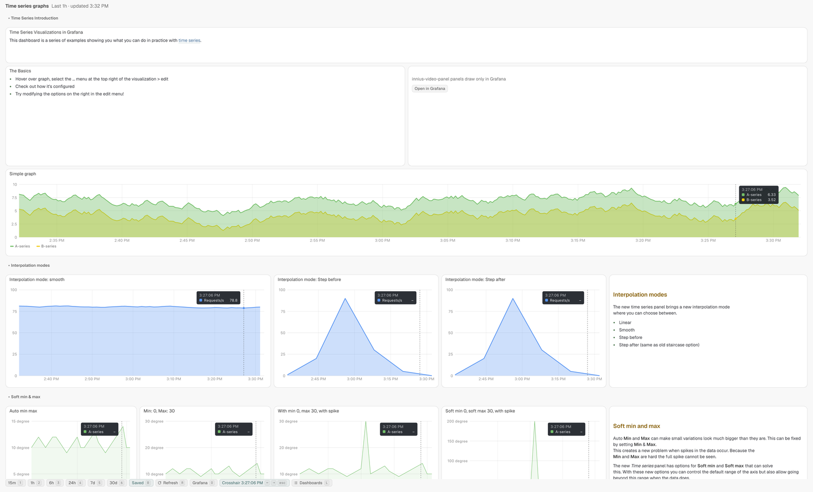

# Grafana for Tern

Read Grafana dashboards in a native Tern pane. Open **Open Grafana dashboard** from the command palette or press **Ctrl+Alt+G**, pick a dashboard, and read its panels laid out on Grafana's 24-column grid.



- Stat, gauge, bar gauge, table, logs and text panels draw as native Tern views, with Grafana's units, decimals, thresholds, value mappings, overrides and the common transformations (merge, organize, sort by, filter by name, convert field type, extract fields).
- Time series, state timeline and bar chart panels draw as vector images in the theme's colors: time series with legends, thresholds, stacking and bar or line styles; state timelines with value mappings, merged states and a legend of the mapped states; bar charts with grouped or stacked bars, a second axis for fields placed right, and either orientation.
- A keyboard crosshair stands in for hover tooltips: the arrow keys move one shared time across every time series, state timeline and time-axis bar chart, and each draws the values at that time in a tooltip beside it (in the panel's tooltip sort order; panels with tooltips off draw only the line).
- Alert list panels list Grafana-managed alert rules from Grafana's rules API, with the panel's state, name, folder, dashboard and label filters, custom grouping, sort order and item limit.
- Other panel types (node graphs, community panels) show a card with **Open in Grafana**.
- Template variables use their saved values. Query variables saved without options are looked up from Prometheus (`label_values`) or Loki labels; All expands to every value, as in Grafana.
- Collapsed rows stay collapsed; click a row title to expand it and query its panels.

Keys in a dashboard pane:

| Key | Action |
| --- | --- |
| `1`–`6` | Last 15m, 1h, 6h, 24h, 7d, 30d |
| `0` | The dashboard's saved range |
| `r` | Refresh now |
| `o` | Open the dashboard in Grafana |
| `l`, Backspace | Back to the dashboard list (`j`/`k` or arrows to move, Enter to open) |
| `←`/`→` | Move the crosshair (the first press puts it at the range's end); Shift moves five times as far |
| Esc | Hide the crosshair |

Dashboards with an auto-refresh interval refresh on it, at most every 15 seconds.

## Install

Requires Tern's native plugin API. Verified on macOS with Tern 0.9.11 against Grafana 13.2 and 13.4.

```sh
tern plugin install github.com/wolfiesch/tern-grafana
tern plugin list
```

Or clone the repository and link it in place:

```sh
git clone https://github.com/wolfiesch/tern-grafana.git
cd tern-grafana
tern plugin link .
tern plugin list
```

`tern plugin list` should show `grafana … ready`. To update an installed copy, run `tern plugin install github.com/wolfiesch/tern-grafana --force`; for a linked clone, `git pull` then `tern plugin reload grafana`. A linked directory must stay in place.

## Connect

Run **Open Grafana dashboard** (Ctrl+Alt+G). The first time, it asks for your Grafana's base URL, such as `https://grafana.example.com`. To change it later, run **Set Grafana URL**. To try the plugin without a Grafana of your own, enter `https://play.grafana.org`, Grafana Labs' public demo.

Authentication:

- A Grafana that allows anonymous viewing, or sits behind an authenticating proxy (Tailscale Serve, an SSO proxy), needs nothing more.
- Otherwise, create a service account with the Viewer role in Grafana (**Administration › Users and access › Service accounts**), add a token, and paste it into **Set Grafana token**. An empty entry clears it. A request that Grafana rejects with HTTP 401 points to this command.

The URL and token are saved in the plugin's data (`kv.json` in Tern's plugin data directory), in plain text: Tern's keychain API is not available to the half of the plugin that sends requests. Use a Viewer token; the plugin never needs more.

For managed setups, `TERN_GRAFANA_URL` and `TERN_GRAFANA_TOKEN` in Tern's launch environment also work. A saved URL wins over `TERN_GRAFANA_URL`; `TERN_GRAFANA_TOKEN` wins over a saved token. On macOS, Tern started from the Dock does not read shell profiles, which is why the palette commands exist.

A dashboard pane runs on the current Tern host, so a remote host needs its own installation and settings.

## Compatibility

- Data sources: anything Grafana's `/api/ds/query` serves (Prometheus, Loki, SQL databases, InfluxDB, TestData and others), since the plugin queries through Grafana rather than the data sources. Query variables saved without options are looked up only for Prometheus and Loki.
- Panels: see the list above. Canvas, pie chart, geomap, node graph and community panels show **Open in Grafana**.
- Hover tooltips: Tern does not report the pointer position to plugins yet, so the keyboard crosshair stands in.

## Data and refresh

All requests run in Tern's host half through `tern.fetch`, six at a time, each with a 30 second deadline. A dashboard loads its JSON, resolves variables, then queries the panels of expanded sections through `/api/ds/query`, the same endpoint Grafana's frontend uses, so data source permissions and server-side expressions apply unchanged. Alert lists read `/api/prometheus/grafana/api/v1/rules`. Errors show on the affected panel or dashboard; a failing panel keeps its last data.

The plugin only reads: it never saves dashboards, silences alerts or changes Grafana state.

## Development

- `grafana.luau`: dashboard model: time ranges, variables, interpolation, query bodies, sections and layout tree.
- `frames.luau`: data frame decoding, Prometheus table folding, transformations, field config, reducers, thresholds and colors.
- `units.luau`, `regex.luau`: Grafana unit formatting and the JavaScript regex subset matchers use.
- `chart.luau`: SVG time series, state timelines and bar charts.
- `panels.luau`: per-panel native views.
- `host.luau`: request queue, dashboard and list blocks.
- `window.luau`: palette commands and dashboard picker.

From this directory, with the Luau CLI installed:

```sh
luau tests/grafana.test.luau tests/frames.test.luau tests/units.test.luau tests/panels.test.luau tests/chart.test.luau
luau-analyze units.luau regex.luau frames.luau chart.luau grafana.luau panels.luau
```

CI runs the same two commands on every pull request and push to `main`.

Unit checks do not verify native rendering; for layout or panel changes, also load the plugin in Tern and inspect real dashboards. `TERN_GRAFANA_URL=https://play.grafana.org tests/headless.sh [N] [OUT]` opens dashboards in a headless Tern, checks that the grid follows the block's width, and saves screenshots of the first N dashboards.

Layout uses only CSS that Tern's renderer supports: Grafana's absolute grid positions become nested rows and stacks (`grafana.tree`), each a `repeat(N, minmax(0, 1fr))` grid whose children span columns. A layout with no straight horizontal or vertical cut stacks its panels in reading order.
